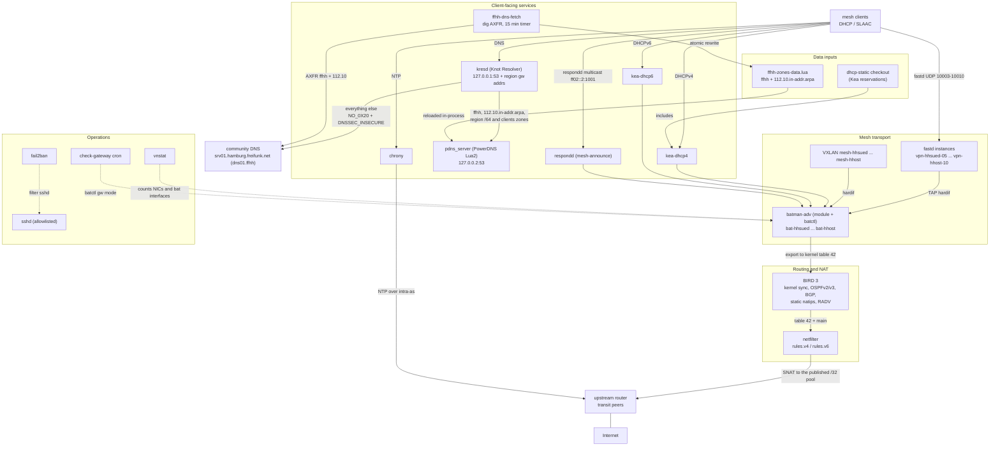
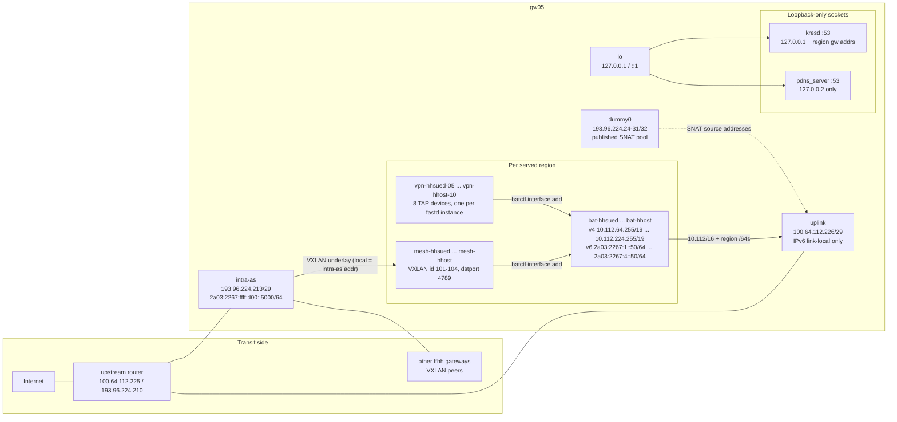
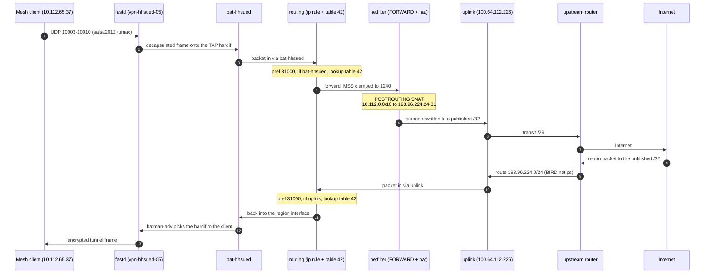
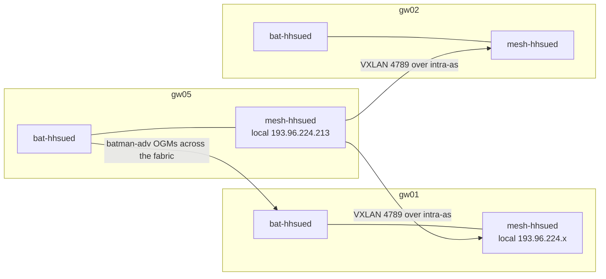
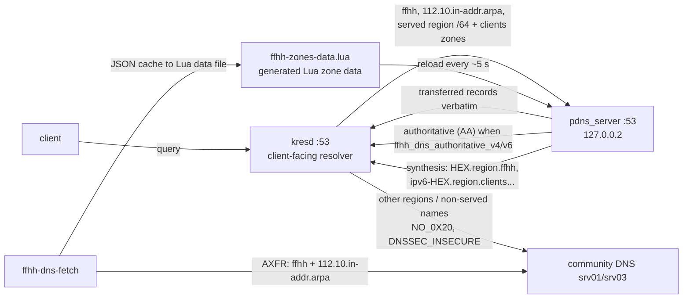
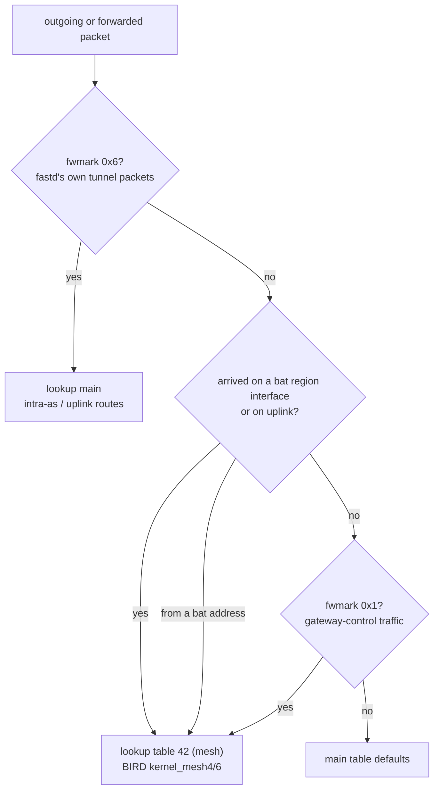
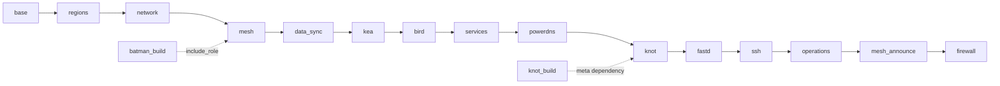

# Component and interface topology

Figures for how the gateway's software fits together and how its Linux
network interfaces relate to client traffic, DNS and the uplink. All
figures are [Mermaid](https://mermaid.js.org/) blocks: they render in
Gitea, GitHub, GitLab and VS Code's markdown preview, and are plain text
in a diff.

Everything drawn here is taken from the rendered configuration in this
repository (templates and inventory), not from a live host. The values
shown are gw05's, the reference host; other gateways get the same shape
with their own addresses.

**Figure index**

| # | Figure | Answers |
|---|---|---|
| 1 | Software components | which daemon does what, and how they depend on each other |
| 2 | Linux interfaces and addressing | which NIC/device carries which address, and how mesh devices stack |
| 3 | Client traffic to the Internet | the forward and return packet path, including NAT and policy routing |
| 4 | Inter-gateway fabric | how VXLAN/batman ties gateways together |
| 5 | DNS resolution path | client → kresd → PowerDNS → community, and where synthesis happens |
| 6 | Routing decision | the `ip rule`/table-42 policy, and the two fwmark values |
| 7 | Apply order | role order as a dependency graph |

## 1. Software components

**Reading it.** Two planes run side by side: *data* (fastd → batman-adv →
BIRD → netfilter → uplink) and *control/answering* (Kea, kresd/PowerDNS,
chrony, respondd). The DNS chain is deliberately split: `kresd` is the only
thing clients see; PowerDNS is a loopback-only authoritative server for the
zones this gateway owns, fed by `ffhh-dns-fetch` and by its own Lua
synthesis. `respondd` and Kea bind to the region bat interfaces, so they only
answer on the client-facing side.

## 2. Linux interfaces and addressing

**Reading it.** Three kinds of device on the host:

- **NICs.** `intra-as` carries the public `/29` and the IPv6 transit block;
  `uplink` carries the transit `/29` plus link-local IPv6 only (no SLAAC, no
  RA-provided default — v6 egress is routed by OSPFv3). `dummy0` is a dummy
  device that exists only to hold the published SNAT `/32`s; it has no IPv6.
  `lo` carries the loopback-only DNS sockets.
- **Mesh devices.** `bat-<region>` is the batman-adv soft interface that
  clients see: it holds the gateway's region address (region network `+250+N`,
  region prefix `+N*0x10`) and is the interface Kea, RADV and respondd use.
  `vpn-<region>-NN` are the fastd TAP hardifs; `mesh-<region>` is the VXLAN
  hardif to the other gateways. Both are attached to `bat-<region>` with
  `batctl`.
- **Sockets.** `kresd` listens on `127.0.0.1`/`::1` and on each region's
  gateway address (the DHCP-advertised resolver). PowerDNS listens only on
  `127.0.0.2`, so it is never reachable from the mesh — kresd forwards to it
  and no firewall rule is needed.

## 3. Client traffic to the Internet

**Reading it.** Inbound mesh traffic enters on the transit side — peers dial
the `intra-as` address (fastd binds `any:<port>`) — is decapsulated onto a
TAP, and lands in `bat-<region>`. From there the policy rules send it to **table 42** (the mesh
table BIRD populates), netfilter clamps MSS and rewrites the source to one of
the published `193.96.224.24-31`, and it leaves via `uplink`. Return traffic
for those `/32`s comes back from the upstream router; whichever transit NIC
it arrives on, BIRD also syncs the mesh routes into `main`
(`kernel_main4/6`), so forwarding can reach the region either way, and
batman-adv selects the tunnel back to the client. `dummy0` holds the `/32`s
so the host owns them as local addresses.

Two marks matter: fastd sets **fwmark `0x6`** on its own tunnel packets so
they leave over `main` (the transit route), and netfilter sets **fwmark
`0x1`** on traffic from `uplink`/`bat-*` (the gateway-control path), which
`check-gateway` ensures is routed through table 42.

## 4. Inter-gateway fabric

**Reading it.** Each served region has its own VXLAN segment. The underlay is
the gateways' `intra-as` addresses, and the peers come from the gateway
registry in `group_vars/all` — adding a gateway updates every VXLAN peer list
and every BGP neighbour automatically. batman-adv runs on top, so a client
attached to any gateway's region can reach any other gateway in the fabric.

## 5. DNS resolution path

**Reading it.** `kresd` never talks to the community for a zone this gateway
owns; it forwards it to the local PowerDNS, which answers from transferred
content first and synthesis second. Inside those zones, names that match
neither a transferred record nor a synthesized pattern get NODATA from the
local PowerDNS -- they are not passed upstream. What does go upstream is the
reverse space this gateway does not own (other regions' `/64`s, and the rest
of the `/32`), with `NO_0X20` because the upstream backend is case-sensitive
and `DNSSEC_INSECURE` because those answers are unsigned. The fetch timer is
the only moving part: zones are as fresh as the last successful AXFR, and a
failed transfer keeps the previous data.

## 6. Routing decision

**Reading it.** Policy routing is how the gateway keeps mesh and transit
traffic apart with one routing daemon. Table 42 is written by BIRD's
`kernel_mesh4`/`kernel_mesh6` protocols from the `mesh4`/`mesh6` tables. The
`ip rule` entries at preference 31000/31001 send traffic arriving on a mesh
interface into table 42 (31001 makes it unreachable while the interface is
down); `check-gateway` also installs a preference-32000 `fwmark 0x1` rule, and
the firewall marks packets arriving on `uplink` or `bat-*` with `0x1`, so
gateway-control traffic is looked up in table 42 too. The `0x6` rule is what
stops fastd's own packets from looping back into the mesh.

## 7. Apply order

**Reading it.** This is a dependency order, not a staging sequence: one run
converges everything, and `--check --diff` shows what would change. `firewall`
is last because every address it needs must already be derived.

## Service and port map

| Service | Bind | Port / socket | Scope |
|---|---|---|---|
| kresd | `127.0.0.1`, `::1`, region `bat-*` addresses | 53 | mesh clients + host |
| pdns_server | `127.0.0.2` | 53 | loopback only (kresd forwards) |
| kea-dhcp4 / kea-dhcp6 | region `bat-*` interfaces | 67 / 547, unix control socket | mesh clients |
| fastd | all interfaces | UDP 10003-10010 (two slots per region) | mesh peers |
| VXLAN | `intra-as` underlay | UDP 4789 | gateway peers |
| respondd | region `bat-*` interfaces | multicast ff02::2:1001, port 1001 | mesh nodes |
| chrony | all interfaces, ACL = mesh aggregates + loopback | UDP 123 | mesh clients + host |
| sshd | all | TCP 22, allowlisted sources | operators |
| ffhh-dns-fetch | host | none (oneshot timer) | data refresh |

## Where to change what

| What you see in the figures | Template / variable |
|---|---|
| `intra-as`, `uplink`, `dummy0` addresses | `roles/network/templates/interfaces.j2`, `interface-loopback.j2`, `host_vars` |
| `bat-<region>`, `vpn-*-NN`, `mesh-<region>` | `roles/mesh/templates/interface-region.j2`, `region_vars`, `gw_index` |
| fastd instances, ports, packet mark | `roles/fastd/*`, `fastd_common_conf`, `tunnel_slots` |
| table 42, OSPF/BGP/RADV | `roles/bird/templates/bird.conf.j2` |
| SNAT, MSS clamp, SSH allowlist | `roles/firewall/templates/rules.v4.j2`, `rules.v6.j2`, `gw_ssh_allowlist` |
| kresd forwards | `roles/knot/templates/kresd.conf.j2` |
| PowerDNS zones and synthesis | `roles/powerdns/templates/ffhh-synth.lua.j2`, `defaults/main.yml` |
| Reverse-zone authority (v4 / v6) | `ffhh_dns_authoritative_v4`, `ffhh_dns_authoritative_v6` (Lua zone claim + kresd `{auth = true}`) |
| Transferred zone set | `ffhh_dns_axfr_zones`, `ffhh_dns_axfr_masters` |
| Kea subnets and pools | `roles/kea/templates/kea-dhcp*.conf.j2`, `gw_kea_pools` |
| respondd domains | `roles/mesh_announce/templates/respondd.conf.j2` |

If a template changes the topology, update the matching figure in this
file — the figures are only useful if they track the rendered config.
